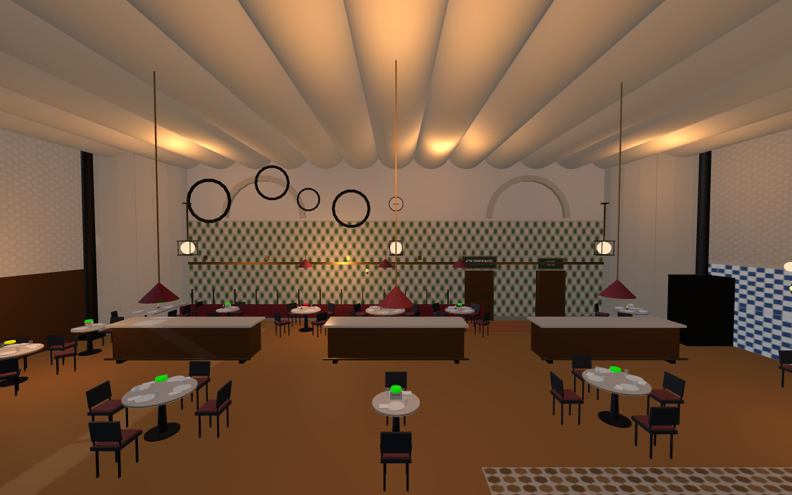

# 🍽️ Restaurant XR — El Nacional

**Un bistrot barcelonais qu'on visite dans le navigateur : on entre depuis la rue, on marche dans la nef, on choisit sa place sur le plan, on lit la carte — à l'écran ou en réalité virtuelle.**



<sub>Rendu du monde du projet via `tools/preview.html` (aperçu WebGL) : quinze voûtes catalanes, colonnes de fonte, mosaïque ivoire et verte, îlots de bar en marbre.</sub>

Projet académique — **Extended Reality (XR)** · SUP'COM · 2026–2027
Encadrant : **Dr. Ing. Mohamed-Bécha Kaâniche**
Équipe : **Slim Selmi · Hazem Bellili · Wassim Hajji**

[](https://threejs.org/)
[](docs/MIGRATION_R160_R187.md)
[](docs/PWA.md)
[](tests/smoke.html)
[](LICENSE)
[Démo : entrée → sélection de table → réservation](docs/demo.gif)

---

## En trente secondes

Une réservation de restaurant classique ne dit pas où l'on sera assis. **Restaurant XR** en fait
un lieu : une salle en 3D où chaque table porte son état, sa zone et sa capacité, où l'on
**marche** entre les tables, où l'on **clique** une table pour lire la carte, et où l'on
**réserve** la place qui correspond à ce qu'on cherche — près de la fenêtre, dans un coin,
au calme, ou loin des toilettes.

Le décor n'est pas inventé : il s'appuie sur une reconstitution documentée d'**El Nacional
(Barcelone)** — nef de 8 m, quinze voûtes catalanes, colonnes de fonte, verrières, trois îlots
de bar en marbre, mosaïques ivoire et verte. Les sources et les choix sont dans
[`docs/WORLD.md`](docs/WORLD.md).

| Ce qu'on peut faire   | Détail                                                                                               |
| --------------------- | ---------------------------------------------------------------------------------------------------- |
| **Explorer**          | marche à hauteur d'yeux (`ZQSD`/`WASD` + souris), balancement du pas, respiration à l'arrêt          |
| **Choisir une place** | critères : fenêtre, coin, banquette, bar, au calme, loin des WC ; les tables compatibles s'éclairent |
| **Consulter**         | clic sur une table → fiche (zone, capacité, statut) + **carte barcelonaise** de 18 plats             |
| **Réserver**          | bouton explicite dans la fiche, désactivé si la table n'est pas libre                                |
| **Entrer en VR**      | session `immersive-vr` à la manette, avec panneau d'état lisible dans le casque                      |
| **Passer en AR**      | `immersive-ar` : le restaurant se pose en maquette sur une surface réelle                            |
| **Installer**         | PWA installable, utilisable hors-ligne, mise à jour signalée                                         |

---

## Lancer le projet

```bash
git clone https://github.com/slim40-jpg/restaurant-xr.git
cd restaurant-xr
npm install                 # outils de développement uniquement
python -m http.server 8000
```

Puis ouvrir **http://localhost:8000**.

> **WebGPU est requis.** Sans adaptateur, l'application affiche un écran « WebGPU requis » avec
> la marche à suivre, plutôt que de basculer silencieusement en WebGL. Vérifier avec
> `chrome://gpu` → `WebGPU: Hardware accelerated`, ou dans la console :
> `navigator.gpu.requestAdapter().then(console.log)`.

`localhost` est nécessaire : c'est le seul contexte (avec HTTPS) où service worker,
installation PWA et WebXR fonctionnent ensemble. L'application se lance **dehors**, face à la
façade : on entre en marchant.

### Commandes

| Commande                  | Effet                                                             |
| ------------------------- | ----------------------------------------------------------------- |
| `npm run verify`          | En-têtes + contrôle du plan + ESLint + Prettier                   |
| `npm run check:layout`    | 20 tables, distances minimales, dégagements, hauteurs praticables |
| `npm run check:headers`   | `@file`, `@author`, `@date`, `@role` et ≤ 200 lignes par module   |
| `npm run lint` / `format` | ESLint (flat config) / Prettier                                   |

### Commandes de jeu

| Action                | Touche                                                     |
| --------------------- | ---------------------------------------------------------- |
| Marcher               | `ZQSD` ou `WASD`, flèches en secours ; `Maj` pour courir   |
| Regarder              | Souris (pointer lock, `Échap` pour libérer)                |
| Changer de mode       | `V` — Marcher ↔ Orbite                                     |
| Couper le balancement | `M` (respecte `prefers-reduced-motion`)                    |
| Choisir une table     | Clic au **réticule** en marchant, ou clic direct en orbite |

---

## Sous le capot

**47 modules**, une responsabilité par fichier, aucun au-delà de 200 lignes, aucune dépendance
circulaire.

```
src/
├── main.js          câblage (199 lignes, aucune règle métier)
├── config/          constantes du lieu, carte du restaurant
├── core/            renderer WebGPU, scène, service worker
├── world/           plan, architecture, voûtes, façade, décor, mobilier, surfaces praticables
├── xr/              manette VR, mode AR (hit-test, réticule), vestibule
├── interaction/     sélection, souris, orbite, marche, recommandation
└── ui/              fiche table, carte, préférences, panneaux, réticule, écran de blocage
```

Trois décisions portent le reste :

1. **Le plan est une donnée.** `world/layout.js` décrit les 20 tables (position, zone,
   capacité, caractéristiques) et `scripts/check-layout.mjs` **prouve** les distances à chaque
   `npm run verify`.
2. **Sélectionner n'est pas réserver.** Le clic ouvre une fiche ; la transition
   `available → reserved` n'existe que dans `reserve()`, appelée par un bouton.
3. **Le rendu est vérifié, pas supposé.** `core/renderer.js` interroge le backend après
   initialisation et bloque l'application si WebGPU n'est pas actif. Le badge affiche toujours
   le backend réellement utilisé.

Détail : [`docs/ARCHITECTURE.md`](docs/ARCHITECTURE.md) · données : [`docs/technical_specs.md`](docs/technical_specs.md)

---

## Qualité

```bash
$ npm run verify
47/47 fichier(s) conforme(s).
Plan conforme.
All matched files use Prettier code style!
(eslint : aucune erreur)
```

- **29 assertions** dans un vrai navigateur ([`tests/smoke.html`](tests/smoke.html)) : décor, identifiants
  stables, niveaux, sélection sans réservation, `reserve()` idempotent, classement déterministe,
  panneau 3D, clic vs glisser.
- **Contrôle du plan** exécuté à chaque `verify` : 20 tables, écart minimal, dégagement des murs,
  hauteurs praticables.
- **Logique de marche testée hors navigateur** : arrêt à 0,280 m d'un mur (= rayon du joueur),
  glissement le long d'une paroi, montée d'escalier, tangage écrêté.
- **Preuves par jalon** : commandes et sorties réelles dans [`docs/DEMO_LOG.md`](docs/DEMO_LOG.md).

---

## Documentation

| Document                                                     | Contenu                                              |
| ------------------------------------------------------------ | ---------------------------------------------------- |
| [`docs/WORLD.md`](docs/WORLD.md)                             | Le lieu : nef, voûtes, surfaces praticables, sources |
| [`docs/technical_specs.md`](docs/technical_specs.md)         | Exigences, modèle de données, machine à états, dette |
| [`docs/ARCHITECTURE.md`](docs/ARCHITECTURE.md)               | Graphe de modules, flux, invariants                  |
| [`docs/CONTROLS.md`](docs/CONTROLS.md)                       | Commandes et ressenti de la caméra                   |
| [`docs/MENU.md`](docs/MENU.md)                               | Carte barcelonaise et choix de conception            |
| [`docs/PWA.md`](docs/PWA.md)                                 | Installabilité, hors-ligne, audit                    |
| [`docs/AR.md`](docs/AR.md)                                   | Mode réalité augmentée et limites                    |
| [`docs/MIGRATION_R160_R187.md`](docs/MIGRATION_R160_R187.md) | Migration Three.js et décision WebGPU                |
| [`docs/DEMO_LOG.md`](docs/DEMO_LOG.md)                       | Journal de preuves par semaine                       |
| [`docs/prompts/`](docs/prompts/)                             | Journal des prompts et du modèle utilisé             |
| [`docs/adr/`](docs/adr/)                                     | Décisions d'architecture                             |

`tools/preview.html` rend le même monde en WebGL, pour produire des captures sur une machine
sans WebGPU : `?view=salle|rue|bar|terrasse|nave-large`.

---

## Équipe

| Membre            | Rôle                          | Périmètre                                                        |
| ----------------- | ----------------------------- | ---------------------------------------------------------------- |
| **Slim Selmi**    | Développement 3D / WebXR      | `src/core/**`, `src/world/**`, `src/xr/**`                       |
| **Hazem Bellili** | Intégration assets / UI       | `src/ui/**`, `assets/**`, styles                                 |
| **Wassim Hajji**  | Réservation / tests / backend | `src/main.js`, `src/config/**`, `src/interaction/**`, `tests/**` |

---

## Limites assumées

- **Pas de backend** : l'état des tables est local à l'onglet.
- **VR non validée sur casque** : WebGPU-XR reste expérimental ; le mode dépend du navigateur du casque.
- **AR non testée sur appareil ARCore** : implémentation et repli vérifiés, pose non.
- **Salle vide** : aucun personnage, ce qui trahit encore la maquette.
- **Pas encore de vitrine éclairée ni de trottoir** derrière la façade.

---

## Licence

Code sous **MIT** — voir [`LICENSE`](LICENSE). Les modèles 3D de `assets/` ne sont pas couverts :
voir [`ATTRIBUTION.md`](ATTRIBUTION.md).
