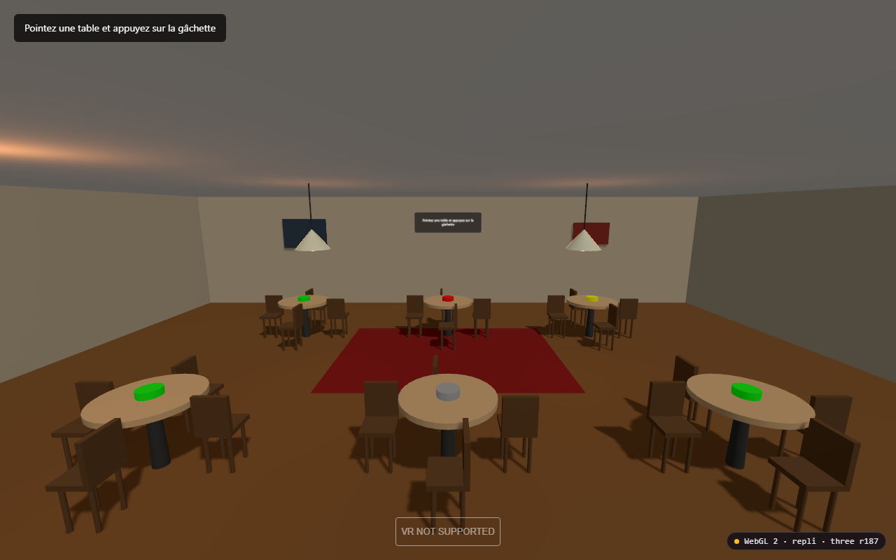
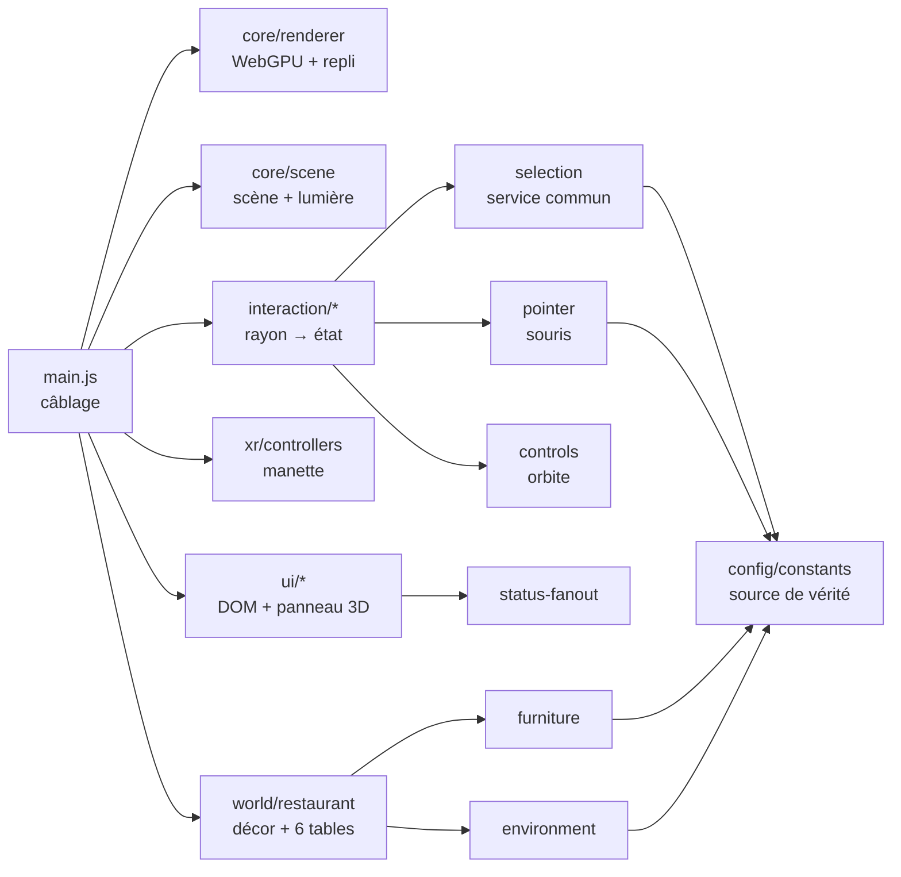
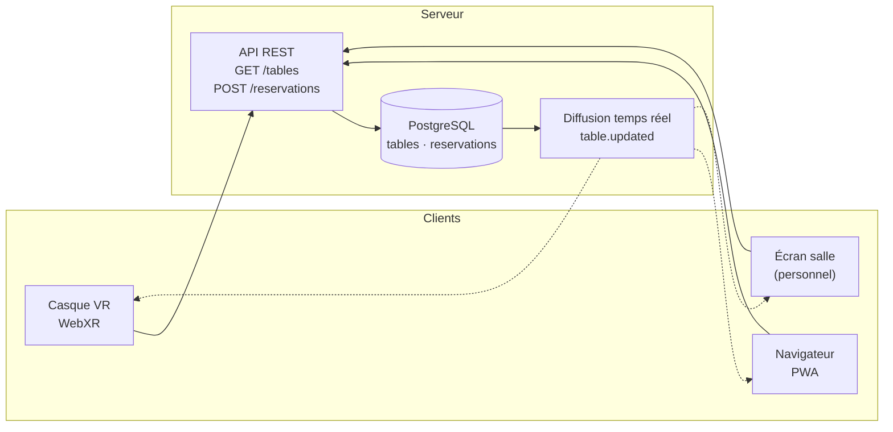

# 🍽️ Restaurant XR

**Le plan de salle d'un restaurant, vivant, lisible en VR comme sur le web.**

Application WebXR : la salle est modélisée en 3D, chaque table porte son état réel
(disponible, occupée, réservée, indisponible), et un client réserve en pointant la
table — avec une manette VR ou une simple souris. Aucune installation native :
tout tourne dans le navigateur.

[](https://threejs.org/)
[](https://www.w3.org/TR/webxr/)
[](docs/MIGRATION_R160_R187.md)
[](LICENSE)
[](tests/smoke.html)

Projet académique — **Extended Reality (XR)** · SUP'COM · 2026–2027
Encadrant : **Dr. Ing. Mohamed-Bécha Kaâniche** · Équipe : **Slim Selmi · Hazem Bellili · Wassim Hajji**



> Capture réelle, rendue en navigateur : six tables, marqueurs d'état, lampes,
> panneau de réservation au fond de la salle et badge de backend en bas à droite.

---

## Le problème

Un plan de salle papier ou un tableur ne dit pas ce que le client voit. Un menu de
réservation classique ne dit pas où il sera assis. Les deux vivent dans des outils
séparés, et le personnel arbitre les conflits de tête.

**Restaurant XR** réunit les deux : une seule scène 3D qui porte l'état réel du
service, consultable par le client (web ou casque) et par le personnel. L'objectif
du cours n'est pas la démonstration graphique : c'est de traiter ce plan de salle
comme un **système** — état partagé, transitions explicites, backends interchangeables,
comportement vérifiable.

---

## État du projet

**Jalon courant : W2 terminé** — rendu moderne et démonstration utilisable.
Prochain : W3 (PWA + déploiement).

| # | Jalon | Thème | État |
| --- | --- | --- | --- |
| W1 | Socle d'ingénierie | Code modulaire, `/docs`, en-têtes, outillage, historique Git | ✅ |
| W2 | Rendu moderne | Three.js r187, WebGPU + repli WebGL2, souris, panneau 3D | ✅ |
| W3 | PWA | Manifeste, service worker, hors-ligne, déploiement HTTPS | 🔄 |
| W4 | Immersion | Téléportation joystick, dolly joueur, modèles GLB, Vitest | ⬜ |
| W5 | Backend 1/2 | Identifiants stables, schéma, API REST, conflits `409` | ⬜ |
| W6 | Backend 2/2 | Temps réel WebSocket, CI/CD, release `v1.0.0` | ⬜ |

Détail, critères d'acceptation et risques : [`docs/PLANNING.md`](docs/PLANNING.md).

### Fonctionnalités

| Fonctionnalité | État | Jalon |
| --- | --- | --- |
| Salle 3D : sol, murs, plafond, 6 tables, 24 chaises, lampes, décor | ✅ | — |
| Session immersive `immersive-vr` (WebXR) | ✅ | — |
| Manette VR : modèle 3D, rayon de visée, gâchette | ✅ | — |
| Sélection d'une table par raycasting | ✅ | — |
| États de table et marqueurs colorés | ✅ | — |
| Réservation : transition d'état visible et confirmée | ✅ | — |
| Three.js r187 + `WebGPURenderer` | ✅ | W2 |
| Repli WebGL2 automatique, y compris en session XR | ✅ | W2 |
| Badge de backend à l'écran (preuve visible) | ✅ | W2 |
| Utilisation sans casque : orbite + clic pour réserver | ✅ | W2 |
| Panneau d'état 3D lisible **dans** le casque | ✅ | W2 |
| Installable et hors-ligne (PWA) | 🔄 | W3 |
| Téléportation au joystick | ⬜ | W4 |
| Réservations persistées et synchronisées entre clients | ⬜ | W5 |

---

## Démonstration en 60 secondes

```bash
git clone https://github.com/slim40-jpg/restaurant-xr.git
cd restaurant-xr
npm install
npm run dev          # python -m http.server 8000
```

Ouvrir <http://localhost:8000> :

1. **Glisser** à la souris → la caméra tourne autour de la salle.
2. **Cliquer** une table verte → elle passe en *réservée*, le marqueur devient jaune,
   le panneau au fond de la salle et celui en haut à gauche confirment.
3. Bas à droite : le badge indique le backend réellement actif, `WebGPU` ou
   `WebGL 2 · repli`.
4. **Enter VR** (casque, ou extension *Immersive Web Emulator*) → même scénario à la
   manette, et le panneau du fond reste lisible dans le casque.

Vérification en une commande : <http://localhost:8000/tests/smoke.html> → 18 assertions.

---

## Architecture

Le code est découpé en modules à responsabilité unique, avec un graphe de dépendances
acyclique orienté vers la configuration.



Trois décisions portent le reste :

1. **Un seul service de sélection, deux sources.** Manette et souris produisent un
   `THREE.Ray` ; `createSelectionService` applique la règle métier. Ajouter le regard
   ou le hand-tracking ne touchera pas à la machine à états.
2. **Un état, plusieurs affichages.** `ui/status-fanout` publie le même message sur le
   panneau DOM (desktop) et sur un plan texturé ancré dans la salle (VR). C'est ce qui
   corrige le défaut le plus grave du prototype : un retour utilisateur invisible
   là où l'application est censée vivre.
3. **Le backend de rendu est un détail remplaçable.** `core/renderer` expose
   `getRenderer()` ; `setupWebGLXRFallback` remplace le renderer au moment d'ouvrir
   une session si le casque n'expose pas `XRGPUBinding`. Aucun autre module ne sait
   lequel tourne.

Graphe complet, flux d'exécution et invariants : [`docs/ARCHITECTURE.md`](docs/ARCHITECTURE.md).

---

## Ce que ce projet démontre

- **WebXR de bout en bout** — session `immersive-vr`, poses tête/manettes, raycasting
  depuis un contrôleur, boucle `XRSession.requestAnimationFrame`.
- **Une migration de rendu maîtrisée** — r160 → r187, `WebGPURenderer`, et le repli
  officiel `WebGLXRFallback` parce que WebGPU+WebXR reste expérimental en 2026.
  Preuves et limites : [`docs/MIGRATION_R160_R187.md`](docs/MIGRATION_R160_R187.md).
- **Une logique métier testable** — la sélection ne dépend pas d'un événement XR :
  elle prend un rayon. Elle est donc exécutable dans un vrai navigateur, sans casque.
- **De l'ingénierie vérifiable** — 15 modules ≤ 200 lignes, en-têtes `@file/@author/
  @date/@role` imposés par un script, ESLint + Prettier bloquants, 18 assertions.
- **Une gestion de projet lisible** — un jalon = une branche = des commits
  conventionnels = une preuve archivée dans [`docs/DEMO_LOG.md`](docs/DEMO_LOG.md).

---

## Vision produit — à quoi ressemblera la v1.0

L'objectif n'est pas « un décor 3D de plus ». C'est **un plan de salle partagé en
temps réel**, dont la 3D est l'interface.

| Aujourd'hui (W2) | v1.0 (fin W6) |
| --- | --- |
| Un seul onglet, état local | Plusieurs clients, état serveur unique |
| Réservation simulée | Réservation persistée, annulable, avec conflits gérés |
| Caméra fixe en VR | Téléportation au joystick, confort validé |
| Page web | PWA installable, utilisable hors-ligne |
| Décor procédural | Modèles GLB du restaurant intégrés et optimisés |

**Le moment de démonstration visé** : deux fenêtres côte à côte, une seule table.
Le premier client réserve — le second reçoit un refus en moins de 500 ms, son
interface revient en arrière et affiche `TABLE_ALREADY_RESERVED`. C'est ce plan-là
qui distingue une application d'une démonstration.



Schéma SQL, protocole, gestion de conflit et alternatives écartées :
[`docs/PLANNING.md`](docs/PLANNING.md) §3 (W5).

---

## Qualité

| Commande | Effet |
| --- | --- |
| `npm run verify` | En-têtes + ESLint + Prettier — bloquant avant fusion |
| `npm run check:headers` | Impose `@file`, `@author`, `@date`, `@role` et ≤ 200 lignes |
| `npm run lint` | ESLint, configuration plate ES2022 |
| `npm run format` | Prettier sur `src/`, `scripts/`, `*.html` |
| `npm run dev` | Serveur statique local (port 8000) |

- **Test fonctionnel** — `tests/smoke.html` : 18 assertions dans un vrai navigateur
  (décor, états initiaux, réservation, panneau 3D, diffusion, clic vs glisser).
- **Preuves par jalon** — commandes, sorties réelles et points non vérifiés dans
  [`docs/DEMO_LOG.md`](docs/DEMO_LOG.md). Ce qui n'a pas été testé y est écrit.

---

## Documentation

| Document | Contenu |
| --- | --- |
| [`docs/technical_specs.md`](docs/technical_specs.md) | Exigences, architecture, modèle de données, machine à états, APIs, dette |
| [`docs/PLANNING.md`](docs/PLANNING.md) | Jalons W1–W5, critères d'acceptation, risques, choix de backend |
| [`docs/ARCHITECTURE.md`](docs/ARCHITECTURE.md) | Graphe de modules, flux d'exécution, invariants |
| [`docs/MIGRATION_R160_R187.md`](docs/MIGRATION_R160_R187.md) | Migration Three.js, WebGPU, preuves d'exécution |
| [`docs/DEMO_LOG.md`](docs/DEMO_LOG.md) | Preuve d'avancement semaine par semaine |
| [`docs/adr/`](docs/adr/) | Décisions d'architecture et alternatives écartées |
| [`CONTRIBUTING.md`](CONTRIBUTING.md) | Branches, commits conventionnels, revues, périmètres |
| [`ATTRIBUTION.md`](ATTRIBUTION.md) | Origine et licences des ressources 3D |

---

## Stack

| Brique | Version | Rôle |
| --- | --- | --- |
| Three.js | r187 (`0.187.0`) | `WebGPURenderer`, repli WebGL2, scène et matériaux |
| WebGPU / WebGL 2 | — | Rendu GPU, bascule automatique selon le matériel |
| WebXR Device API | — | Session immersive, poses tête et manettes |
| WebXR Input Sources | — | Modèles de manettes, axes, gâchettes |
| Canvas 2D + `CanvasTexture` | — | Panneau de statut lisible dans le casque |
| ES Modules + import map | — | Aucune étape de build |
| ESLint 9 · Prettier 3 · Node 20+ | — | Qualité et formatage |

---

## Structure du dépôt

```
restaurant-xr/
├── index.html                  # Page hôte, import map, panneau DOM
├── src/
│   ├── main.js                 # Câblage : 70 lignes, aucune règle métier
│   ├── config/                 # Constantes, plan des tables, libellés
│   ├── core/                   # Renderer (WebGPU + repli), scène, éclairage
│   ├── world/                  # Décor, mobilier, composition du restaurant
│   ├── xr/                     # Manette, bouton VR, rayon de visée
│   ├── interaction/            # Sélection (manette/souris), orbite
│   └── ui/                     # Panneaux DOM et 3D, diffusion, badge
├── docs/                       # Spécifications, planning, ADR, preuves
├── tests/smoke.html            # 18 assertions navigateur
├── scripts/                    # Vérificateur d'en-têtes
├── assets/                     # Modèles 3D (intégration W4)
└── package.json
```

---

## Équipe

| Membre | Rôle | Périmètre de code |
| --- | --- | --- |
| **Slim Selmi** | Développement 3D / WebXR | `src/core/**`, `src/world/**`, `src/xr/**` |
| **Hazem Bellili** | Intégration assets / UI | `src/ui/**`, `assets/**`, styles |
| **Wassim Hajji** | Réservation / tests / backend | `src/main.js`, `src/config/**`, `src/interaction/**`, `tests/**` |

---

## Limites assumées

- **Pas de persistance** : l'état des tables est local à l'onglet (W5).
- **Pas encore installable** : manifeste et service worker en W3.
- **Caméra fixe en VR** : téléportation en W4.
- **WebGPU+WebXR expérimental** : le repli WebGL2 prend le relais et le badge
  l'affiche. La session immersive n'a pas encore été validée sur casque physique.
- **Licence des modèles Sketchfab** à confirmer avant toute redistribution (DT-08).

Liste priorisée : [`docs/technical_specs.md`](docs/technical_specs.md) §11.

---

## Licence

Code sous **MIT** — voir [`LICENSE`](LICENSE). Les modèles 3D de `assets/` ne sont
pas couverts par cette licence : voir [`ATTRIBUTION.md`](ATTRIBUTION.md).
